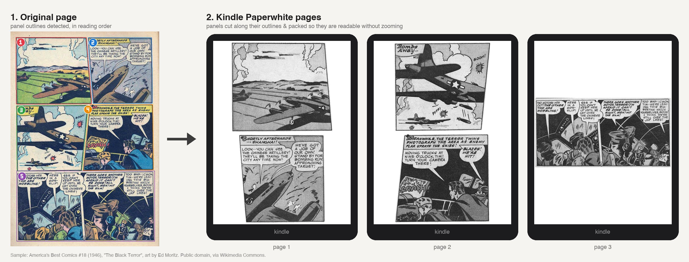

# comic-kindle

Detects comic panels, crops them, and repacks them onto pages sized for a specific Kindle,
so every panel is readable without zooming.



<sub>Sample page: *America's Best Comics* #18 (1946), "The Black Terror", art by Ed Moritz.
Public domain, via [Wikimedia Commons](https://commons.wikimedia.org/wiki/File:AmericasBestComics1804.jpg).</sub>

## Build

```sh
cargo build --release
# binary: target/release/comic-magic
```

PDF input needs `mutool` (MuPDF) or `pdftoppm` (Poppler) on PATH (`brew install mupdf`).
CBR/CB7 input uses `bsdtar` (built into macOS), `unar` or `7z`.

## Use

```sh
comic-magic mycomic.cbz                       # asks which Kindle you have
comic-magic mycomic.pdf -d paperwhite-5       # -> mycomic_paperwhite-5.pdf
comic-magic pages/ -d kindle-11 -f cbz        # folder of images -> CBZ
comic-magic manga.cbz -d oasis --rtl --print-height 7.2
comic-magic --list-devices
comic-magic in.cbz --width 1072 --height 1448 --ppi 300   # custom screen
```

Copy the output PDF to the Kindle's `documents` folder over USB. Each page is exactly the
size of the screen.

## How it works

1. **Input**: PDF pages are rendered at `--pdf-dpi`. Archives are extracted, and images are
   sorted in natural order (`p2` comes before `p10`).
2. **Panel detection**: the paper colour is the median of the page edge. Everything that differs
   from it by more than `--threshold` counts as ink. Paper reachable from the page edge, plus thin,
   long strips of paper, form the gutters. Everything else becomes a solid blob, with each panel's
   interior filled in. Each blob is one panel candidate. When a speech balloon crosses a gutter and
   joins two panels, the blob is cut along lines that are mostly empty (`--split-coverage`). Panels
   are then put in reading order: rows top to bottom, then left to right, or right to left with
   `--rtl`. Small regions such as page numbers are dropped.

   Each panel keeps its outline (the convex hull of its blob), so slanted and irregular panels
   are cut out exactly and slivers of neighbouring panels are painted white. Use `--rect-crop`
   to crop plain bounding boxes instead.
3. **Layout**: each panel must appear at least `--readable-scale` (default 0.8) times its printed
   size. The tool works this out from the device ppi and `--print-height`. Panels from the same
   row stay side by side when they fit. Otherwise they are stacked. Each Kindle page is filled
   with as many panels as fit, and then scaled up to use any leftover space.
4. **Output**: grayscale JPEG pages (colour on Colorsoft or with `--color`), saved as PDF, CBZ or
   an image folder.

## Tuning

| Problem | Try |
|---|---|
| Text still too small | `-s 1.0` (or higher) |
| Too few panels per page | `-s 0.65` |
| Wide panels too small | `--rotate` (puts them in landscape on their own page) |
| Panels merged together | `--split-coverage 0.5`, `--threshold 30` |
| Panels split too much | `--split-coverage 0.2` |
| Washed-out e-ink | `--gamma 1.4` |
| Neighbouring panels cut into an L-shaped panel | `--rect-crop` |
| Check detection | `--debug-dir dbg/` writes each page with the detected panel outlines, numbered in reading order |
